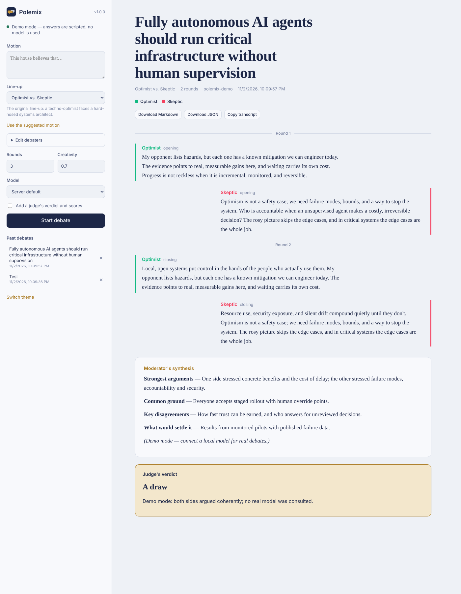

# Polemix

**Structured multi-persona AI debates on your own machine.**

[](https://github.com/valentinakiyungi/polemix/actions/workflows/tests.yml)
[](https://www.python.org/)
[](#)
[](LICENSE)

Give Polemix a motion, choose who argues it, and watch AI debaters take turns
over several rounds — opening statements, rebuttals, closings — before a
moderator sums up the strongest arguments, the common ground and what would
settle the question. Add a judge if you want a winner and scores.

Everything runs locally through [LM Studio](https://lmstudio.ai/),
[Ollama](https://ollama.com/), llama.cpp, vLLM or any other server with an
OpenAI-compatible API. Nothing leaves your computer, and Polemix itself has
**zero required dependencies** — just Python.



## Features

- **Web app and terminal app** — a browser UI with live streaming, or a clean CLI.
- **Real debate structure** — every debater speaks every round, with opening, rebuttal and closing phases, and each speaker sees what was said before.
- **Line-ups** — four built-in casts (Optimist vs. Skeptic, Proposition vs. Opposition, Expert Roundtable, Believer vs. Devil's Advocate), editable in the browser, or your own in a JSON/YAML file. Two to six debaters.
- **Moderator synthesis** and an optional **judge's verdict** with 1–10 scores.
- **Saved transcripts** — every debate is stored as Markdown and JSON, browsable under *Past debates*, downloadable or copyable.
- **Works with reasoning models** — `<think>…</think>` blocks (Qwen3, DeepSeek-R1) are stripped automatically.
- **Auto-detects** the model loaded on your server; pick another from the UI or `--model`.
- **Stop anytime** — the partial transcript is kept.
- **Demo mode** — try the whole app with no model installed: `--demo`.

## Quick start

### 1. Install

```bash
git clone https://github.com/valentinakiyungi/polemix.git
cd polemix
python3 -m venv .venv
source .venv/bin/activate        # Windows: .venv\Scripts\activate
pip install .
```

### 2. Start a model server

**LM Studio:** load a chat model (Llama 3.1 8B, Qwen 2.5 7B, Mistral, Gemma …), open the
**Developer** tab and press **Start Server**. Polemix looks at `http://localhost:1234/v1` by default.

**Ollama:** `ollama pull llama3.1`, then use `--base-url http://localhost:11434/v1`
(or put it in `.env`, see below).

Check the connection:

```bash
polemix check
```

> Tip: very small models (under ~3B parameters) tend to ramble or break character.
> A 7–8B instruct model gives much better debates.

### 3. Debate

```bash
polemix serve                                   # opens the web app at http://localhost:8765
polemix run "Remote work is better than office work"   # or debate in the terminal
```

No model yet? `polemix serve --demo` shows how it all works with scripted answers.

## Command reference

| Command | What it does |
| --- | --- |
| `polemix serve` | Start the web app (`--port`, `--host`, `--no-browser`) |
| `polemix run "motion"` | Run a debate in the terminal |
| `polemix lineups` | List the built-in line-ups |
| `polemix models` | List models available on your server |
| `polemix check` | Test that the server and model respond |
| `polemix history` | List saved debates |
| `polemix show file.json` | Print a saved debate as Markdown |

Useful options for `run`:

```bash
polemix run -l roundtable -r 4 --judge "Cities should ban cars from their centres"
polemix run -l examples/startup-board.json "We should raise a Series A now"
polemix run --model qwen2.5-7b-instruct -t 0.9 --max-tokens 400 "..."
```

`--base-url`, `--model`, `--api-key` and `--demo` work with every command that talks to a model.
Run `polemix <command> --help` for everything.

## Configuration

Settings come from command-line flags, then environment variables, then a `.env`
file in the folder you run Polemix from. Copy `.env.example` to `.env` to start:

| Variable | Default | Meaning |
| --- | --- | --- |
| `POLEMIX_BASE_URL` | `http://localhost:1234/v1` | OpenAI-compatible endpoint (`OPENAI_API_BASE` also works) |
| `POLEMIX_MODEL` | first loaded model | Model id |
| `POLEMIX_API_KEY` | `not-needed` | Only if your server needs one |
| `POLEMIX_ROUNDS` | `3` | Rounds per debate (1–20) |
| `POLEMIX_TEMPERATURE` | `0.7` | Debater creativity (0–2) |
| `POLEMIX_MAX_TOKENS` | `600` | Longest allowed turn |
| `POLEMIX_OUTPUT_DIR` | `debates` | Where transcripts are saved |

## Your own line-ups

Create a JSON (or YAML, with `pip install ".[yaml]"`) file:

```json
{
  "title": "Startup Board Meeting",
  "suggested_topic": "We should raise a large Series A now.",
  "debaters": [
    { "name": "Founder", "role": "an ambitious founder", "instructions": "You push for speed.", "stance": "for" },
    { "name": "CFO", "role": "a cautious CFO", "instructions": "You protect runway.", "stance": "against", "temperature": 0.5 }
  ],
  "moderator": { "name": "Chair", "role": "the board chair", "instructions": "Summarise options and risks." }
}
```

`stance` is `for`, `against` or `neutral` (argues its own view). `color` and
`temperature` are optional. See [`examples/startup-board.json`](examples/startup-board.json).
In the web app, open **Edit debaters** to change any line-up on the fly.

## How it works

```
polemix/
├── engine.py      turn-taking, phases, moderator and judge — emits a stream of events
├── llm.py         tiny OpenAI-compatible streaming client (standard library only) + demo model
├── personas.py    debater personas and built-in line-ups
├── transcript.py  debate records, Markdown/JSON export, saved history
├── cli.py         terminal app
├── server.py      local web server with live streaming (Server-Sent Events)
└── web/           the browser UI (single HTML file)
```

The same event stream drives the terminal, the web app and the tests, so they always behave the same.

## Development

```bash
pip install -e ".[dev]"
pytest
```

The tests run against a fake OpenAI-compatible server, so they need no model and no network.

## License

MIT — see [LICENSE](LICENSE).
